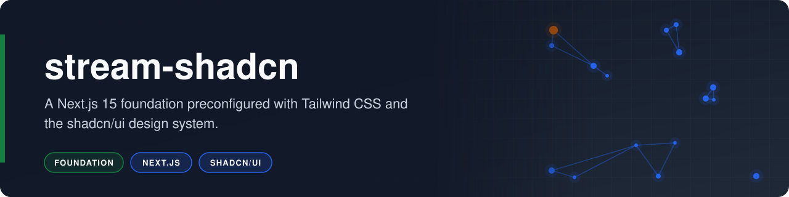

<p align="center"></p>

# stream-shadcn

**A Next.js 15 foundation preconfigured with Tailwind CSS and the shadcn/ui design system.**

    

stream-shadcn is a Next.js 15 project with shadcn/ui initialized as a configuration-only foundation. It provides a lint-clean base with a complete light and dark design token set, ready for shadcn/ui components to be added on demand.

## Overview

The project combines the App Router, TypeScript, and Tailwind CSS 3 with the shadcn/ui configuration in `components.json`. The home page renders a single placeholder line; the value of the repository is the setup around it. The repository is archived and preserved as a reference foundation.

- **Design tokens:** the full shadcn/ui slate palette for light and dark modes, defined as CSS variables in `app/globals.css`.
- **Tailwind theme:** semantic colors, radius scale, and `tailwindcss-animate` wired up in `tailwind.config.ts`.
- **Component tooling:** `components.json` targets the New York style with Lucide icons, and `lib/utils.ts` provides the `cn()` class helper.

## Business Case

### The Problem

Every new interface project repeats the same setup work: choosing a framework, configuring styling, defining design tokens, supporting dark mode, and adding utility helpers. Doing this by hand for each project is slow and produces inconsistent results.

### Who It Serves

- **The author:** a ready base for future interface work.
- **Developers reviewing the work:** a clear view of a standard Next.js and shadcn/ui configuration.

### The Outcome

A clean starting point where `npx shadcn add <component>` places components into `components/ui/` immediately, already styled by the shared token set in both light and dark modes.

## How It Works

The shadcn/ui CLI reads `components.json` to decide where components go and which tokens they use.

1. **Configuration:** `components.json` sets the New York style, slate base color, CSS variables, and the `@/components` and `@/lib` aliases.
2. **Tokens:** `app/globals.css` defines the light (`:root`) and dark (`.dark`) color variables and the base radius.
3. **Theme:** `tailwind.config.ts` maps those variables to Tailwind color names and enables class-based dark mode.
4. **Helper:** `lib/utils.ts` exports `cn()`, which merges conditional class names with `clsx` and `tailwind-merge`.
5. **Layout:** `app/layout.tsx` loads the Geist fonts and imports the global styles; `app/page.tsx` renders the placeholder page.

## Tech Stack

| Layer | Technology | Purpose |
|---|---|---|
| Frontend | Next.js 15.1.7 (App Router) | Routing, rendering, and builds |
| Frontend | React 19 | User interface library |
| Frontend | Tailwind CSS 3 with `tailwindcss-animate` | Utility styling and animation presets |
| Frontend | shadcn/ui (New York, slate) | Component conventions and design tokens |
| Frontend | Lucide React | Icon library used by shadcn/ui components |
| Tooling | TypeScript 5 and ESLint 9 | Type checking and linting |

## Getting Started

### Prerequisites

- Node.js 18.18 or later and npm.
- Network access to Google Fonts during builds (the layout loads Geist through `next/font/google`).

### Installation

1. Clone the repository.

   ```bash
   git clone https://github.com/risingOnIP/stream-shadcn.git
   cd stream-shadcn
   ```

2. Install the dependencies.

   ```bash
   npm ci
   ```

### Usage

```bash
npm run dev
```

Open http://localhost:3000 to see the placeholder page. Other scripts: `npm run lint`, `npm run build`, and `npm run start`.

## Project Structure

```text
stream-shadcn/
├── app/
│   ├── globals.css        # Tailwind layers and shadcn/ui tokens
│   ├── layout.tsx         # Root layout, fonts, and metadata
│   └── page.tsx           # Placeholder home page
├── lib/
│   └── utils.ts           # cn() class name helper
├── components.json        # shadcn/ui CLI configuration
├── tailwind.config.ts     # Theme colors, radius, and plugins
├── eslint.config.mjs      # Next.js lint rules
├── next.config.ts         # Next.js configuration
├── README.md
└── LICENSE
```

## Roadmap

- [ ] Add the first shadcn/ui components (for example Button and Card) under `components/ui/`.
- [ ] Add a theme toggle that switches the `.dark` class.
- [ ] Map the Geist font variables into the Tailwind `fontFamily` theme.
- [ ] Replace the placeholder home page with a landing page.

## Acknowledgments

- Bootstrapped with [create-next-app](https://nextjs.org/docs/app/api-reference/cli/create-next-app).
- Design tokens and component conventions from [shadcn/ui](https://ui.shadcn.com).

## License

Released under the [MIT License](LICENSE).

## Author

Developed by [Karthik Kaligotla](https://github.com/risingOnIP), named inventor on U.S. Patents [12,445,488 B2](https://patents.google.com/patent/US12445488B2/) and [12,598,158 B2](https://patents.google.com/patent/US12598158B2/).
